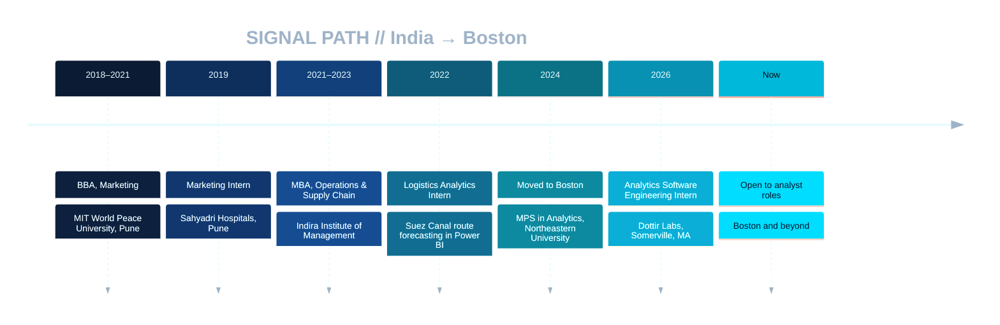

<div align="center">


<a href="https://jayesh-patil.com"></a>


```text
░▒▓█  SIGNAL ACQUIRED · ANALYTICS × OPERATIONS × SUPPLY CHAIN  █▓▒░
```

</div>

## 🛰️ `> whoami`

I turn messy operational data into dashboards, forecasts, and decisions. I bring two lenses to every problem: an analyst's and an operator's, so I start with what the business needs to decide.

- 🌐 **Portfolio:** [jayesh-patil.com](https://jayesh-patil.com)
- 🏅 **Lean Six Sigma Green Belt**
- 💼 Previously **Analytics Software Engineering Intern @ Dottir Labs**: reporting requirements and an automated pipeline across 40+ datasets, plus a self-service KPI dashboard
- 🚢 **Logistics analytics**: forecast Suez Canal shipping traffic in Power BI and mapped alternate routes from port coordinates

---

## 🧭 `> trace --signal-path`



---

## 💼 `> cat mission.log`

> **`[ 2026 ]` Analytics Software Engineering Intern** · Dottir Labs  
> 📍 Somerville, MA &nbsp;|&nbsp; 🗓️ *Jan 2026 – Apr 2026*  
> <sub>`automated pipeline` · `KPI dashboard` · `40+ datasets` · `detection-threshold reporting`</sub>

> **`[ 2022 ]` Logistics Analytics Intern** · Indira Institute of Management  
> 📍 Pune, India &nbsp;|&nbsp; 🗓️ *May 2022 – Jul 2022*  
> <sub>`Suez Canal forecasting` · `Power BI` · `route mapping` · `trade-impact analysis`</sub>

> **`[ 2019 ]` Marketing Intern** · Sahyadri Hospitals  
> 📍 Pune, India &nbsp;|&nbsp; 🗓️ *Aug 2019 – Dec 2019*  
> <sub>`campaign reporting` · `voice-of-customer analysis`</sub>

---

## 🗂️ `> ls ./projects`
<sub>▸ Click a file to decrypt it.</sub>

<details>
<summary><b>📁 FILE_01 · Pharmacy Claims Data Warehouse</b> &nbsp;·&nbsp; <code>SQL · Data Modeling</code></summary>
<br>

**Problem:** Raw pharmacy claims data wasn't usable for reporting.  
**Approach:** Normalized the data to 3NF and designed a MySQL star-schema warehouse (1 fact table + 4 dimension tables) with primary/foreign keys, then built SQL reporting on drug utilization, cost by age segment, and latest fill per member using CTEs and window functions.  
**Result:** A reporting-ready dimensional model with referential integrity. Found and fixed empty fill records that were inflating utilization counts.  

[View repository →](https://github.com/QuietSignal-hub/pharmacy-claims-data-warehouse)
</details>

<details>
<summary><b>📁 FILE_02 · CRM Profiling & RFM Segmentation (YSSL Inc.)</b> &nbsp;·&nbsp; <code>Segmentation · Data Quality</code></summary>
<br>

**Problem:** 65,000+ grant records (2017–2024) with duplicates and no audience structure.  
**Approach:** Team capstone. My part: profiled and cleaned the source data, applied CPI inflation adjustment, built the RFM profiles and segments, wrote the data-quality and governance package, and built the source-validation layer in the app.  
**Result:** **24,350** unique profiles classified into **4** named audience segments; the top segment (19% of recipients) received 74% of funding.  

[View repository →](https://github.com/QuietSignal-hub/crm-rfm-segmentation)
</details>

<details>
<summary><b>📁 FILE_03 · Traffic Crash Injury Prediction & Archetypes</b> &nbsp;·&nbsp; <code>Python · ML</code></summary>
<br>

**Problem:** Predict crash injury severity and find recurring high-risk crash patterns.  
**Approach:** Team project. My part: IQR outlier cleaning (195,092 → 182,237 rows), EDA, an SVM classifier, and K-means crash archetypes. Caught a capitalization bug that had split 5 severity levels into 10 classes.  
**Result:** Crash archetypes by time, location, and conditions, plus targeted road safety recommendations.  

[View repository →](https://github.com/QuietSignal-hub/Traffic-Crash-Analysis-ML)
</details>

<details>
<summary><b>📁 FILE_04 · Energy Consumption Forecasting</b> &nbsp;·&nbsp; <code>R · Time Series</code></summary>
<br>

**Problem:** Understand what drives building energy use and how it shifts by season.  
**Approach:** GLM regression and ARIMA time-series forecasting, with correlation and seasonal trend analysis.  
**Result:** Key consumption drivers and seasonal impacts identified.  

[View repository →](https://github.com/QuietSignal-hub/Energy-Consumption-Analysis)
</details>

<details>
<summary><b>📁 FILE_05 · Global Energy Trends & Nuclear Analysis</b> &nbsp;·&nbsp; <code>Tableau · Visualization</code></summary>
<br>

**Problem:** Track how global energy production and fuel dependency are shifting.  
**Approach:** Tableau dashboards on production trends, with a focus on nuclear energy's role in sustainability and safety.  
**Result:** A visual view of energy diversification and shifts in fuel dependency.  

[View repository →](https://github.com/QuietSignal-hub/Global-Energy-Trends-and-Nuclear-Analysis)
</details>

<details>
<summary><b>🧪 FILE_06 · LLM Content-Moderation Agent</b> &nbsp;·&nbsp; <code>LLM · Toxicity Detection</code> &nbsp;<code>⏳ IN DEVELOPMENT</code></summary>
<br>

An LLM-based agent for content moderation and toxicity detection. Currently in development; the repository link will appear here once it's published.
</details>

---

## 🛠️ `> lsmod --stack`

**Analytics & BI** &nbsp;       

**Programming & Visualization** &nbsp;      

**Machine Learning & Statistics** &nbsp;          

**Data Engineering** &nbsp;      

**Business Analysis** &nbsp;      

**Operations & Supply Chain** &nbsp;     

**Tools** &nbsp;    

---

## 🎓 `> cat credentials.db`

<table width="100%">
<tr>
<td align="center" width="25%" valign="top">
🎓<br>
<b>MPS in Analytics</b><br>
Northeastern University<br>
<sub>Boston, MA · 2024 – 2026</sub><br>
<sub><i>Statistical Modeling</i></sub>
</td>
<td align="center" width="25%" valign="top">
🎓<br>
<b>MBA, Operations & Supply Chain</b><br>
Indira Institute of Management<br>
<sub>Pune, India · 2021 – 2023</sub><br>
<sub><i>Business Analytics</i></sub>
</td>
<td align="center" width="25%" valign="top">
🎓<br>
<b>BBA, Marketing</b><br>
MIT World Peace University<br>
<sub>Pune, India · 2018 – 2021</sub><br>
<sub><i>Marketing · CSR</i></sub>
</td>
<td align="center" width="25%" valign="top">
🏅<br>
<b>Lean Six Sigma Green Belt</b><br>
Anexas<br>
<sub>Certified</sub><br>
<sub><i>Process improvement</i></sub>
</td>
</tr>
</table>

---

## 📡 `> netstat --community`

- 🏥 **MIT Hacking Medicine GrandHack 2026**: Participant, Portable Health track · *Mar 2026*
- ☁️ **GDG Cloud Boston**: Community member · DevFest Boston attendee (2024–2026) · *2024 – Present*
- 🤖 **AI Agent Workshops**: Agentverse (Google Cloud Labs) · Build with AI Boston · *2024 – 2026*

---

## 🧠 `> query --operator`

```sql
SELECT * FROM analysts WHERE name = 'Jayesh Patil'\G
```
```yaml
        name: Jayesh Patil
      status: OPEN_TO_WORK
target_roles: Data Analyst, Business Analyst, BI Analyst, Supply Chain Analyst
  core_stack: SQL, Power BI, Tableau, Python, R, Excel
   strengths: Requirements gathering, KPI reporting, Forecasting, Process improvement
     domains: Logistics, Healthcare, Operations, Public safety data
  heading_to: Cloud, Data & AI
   portfolio: https://jayesh-patil.com
```

---

## 🎯 `> cat interests.cfg`

<table>
<tr>
<th align="left">🤖 &nbsp;At Work</th>
<th align="left">🎧 &nbsp;Off the Clock</th>
</tr>
<tr>
<td valign="top">AI agents & automation<br>Healthcare analytics</td>
<td valign="top">Music · Movies · Reading<br>Sports</td>
</tr>
</table>

### ⚙️ `> upgrade --queue`

- [ ] ☁️ Google Cloud Data Analytics Certificate *(in progress)*
- [ ] 🛡️ LLM content-moderation agent *(in development)*
- [ ] 🧠 Build an AI agent for data analysis (text-to-SQL)
- [ ] 📊 Power BI DAX → PL-300 certification
- [ ] 🧪 A/B testing & experimentation
- [ ] 🏆 Kaggle competitions: first submission

---

<div align="center">

## 📬 `> open --channel`

<a href="https://jayesh-patil.com"></a> <a href="https://www.linkedin.com/in/jayeshp-242e/"></a> <a href="mailto:jayeshp7970@gmail.com"></a> <a href="https://github.com/QuietSignal-hub?tab=repositories"></a> 

<sub>Open to Data Analyst · Business Analyst · BI Analyst · Supply Chain / Operations Analyst roles</sub>

```text
> transmission ended · signal remains open_
```


</div>
